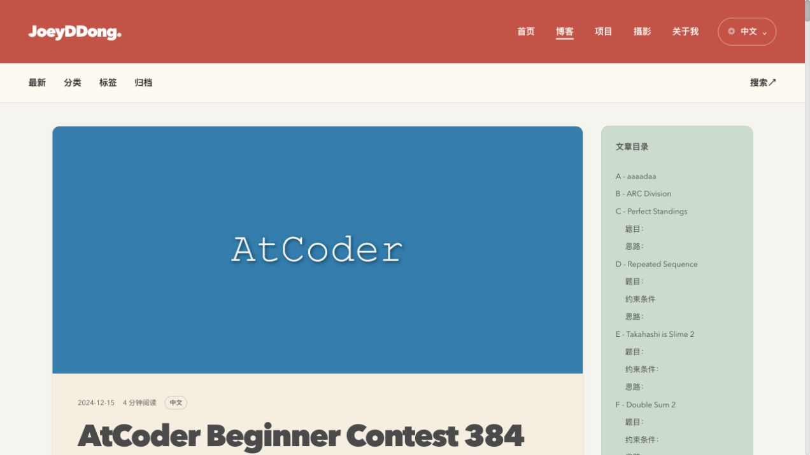

# 旧博客文章迁移记录

## 补充本机未发布笔记（2026-10-17）

按作者此次提供的 20 篇笔记，与当前仓库及线上搜索索引逐篇比对：已有 12 篇，缺少 8 篇。此次补齐后，正式文章共 20 篇，测试草稿继续隐藏。以下初次迁移记录保留其当时的范围与结果。

新增来源为作者本机 `My_Hexo_Blog_Source/source/_posts/`：

- `AtCoder_376_Summary.md`
- `AtCoder_377_Summary.md`
- `AtCoder_390_Summary.md`
- `AtCoder_393_Summary.md`
- `AtCoder_394_Summary.md`
- `AtCoder_395_Summary.md`
- `AtCoder_397_Summary.md`
- `BIT.md`

新增文章沿用现有头部格式：固定文件名 slug、中文原文语言、编程分类、原文摘要、原封面地址和规范化标签，保留标题及原发表时间，不设置虚假的更新时间。正文的代码、图片和链接保留；仅 ABC 390 的 7 处集合公式修正了多余的大括号转义，以便 KaTeX 正常渲染，原始来源文件未修改。

已有 12 篇文章未覆盖。其中 ABC 386、《CPP string 的常用用法》和《质数的基础知识》的本机正文与已发布版本存在差异，按此次仅补齐缺失文章的范围保留博客现有版本。

`content/legacy-posts.json` 追加了本批 8 篇的本机来源、导入日期、原文件哈希及导入后正文哈希；ABC 390 另存原始正文哈希和转义修正说明。清单顶部的仓库、分支及提交仍指初次 GitHub 导入，新条目以各自的 `source`、`source_directory` 为准。

## 初次迁移（2026-10-12）

迁移日期：2026-10-12。当前工作分支：`dev`。

## 来源与复制范围

- 仓库：[weiweiweidong/My_Hexo_Blog_Source](https://github.com/weiweiweidong/My_Hexo_Blog_Source)。
- 来源分支：默认分支 `main`。
- 来源提交：`e7e0f49e4e710caacb9b5247f630700705e4da98`。
- 来源目录：`source/_posts/`，共 **12 篇 Markdown**，该目录没有其他资源文件。
- 目标目录：当前项目的 `source/_posts/`。
- 初次迁移按原文件名、原始字节复制，12 篇均通过 SHA-256 原文一致性校验。
- 随后按用户要求规范化头部字段；当前正文仍与 GitHub 原始版本逐字节一致，标题、发表时间、图片地址与文章网址保持不变。
- 迁移时保留了 12 篇测试文章，共 **24 篇**。2026-10-13 按用户要求将测试文章原样移入 `source/_drafts/`，正常构建现在只发布 **12 篇旧文**；测试内容仍保留。没有覆盖同名内容，没有修改旧项目。

本机另有 `/Users/dongwei/JoeyDong/My_GitHub_Source/My_Hexo_Blog_Source` 副本，包含 20 篇文章，且同名文件也与远程不同。本次严格以用户给出的 GitHub 仓库默认分支为准，未混入本机额外 8 篇或其内容版本。

## 已复制的文章

1. `AtCoder_363_Summary.md`
2. `AtCoder_378_Summary.md`
3. `AtCoder_379_Summary.md`
4. `AtCoder_380_Summary.md`
5. `AtCoder_381_Summary.md`
6. `AtCoder_382_Summary.md`
7. `AtCoder_383_Summary.md`
8. `AtCoder_384_Summary.md`
9. `AtCoder_385_Summary.md`
10. `AtCoder_386_Summary.md`
11. `CPP_string_的常用用法.md`
12. `质数的基础知识.md`

原始整文件哈希、正文哈希及头部规范化日期记录在 [content/legacy-posts.json](./content/legacy-posts.json)。`sha256` 是初次复制时的整文件哈希；`body_sha256` 是移除头部后的原始正文哈希。头部已适配，当前不要求整文件与旧站相同。可使用以下命令核对正文及头部字段：

```sh
node tools/verify-build.cjs --check-import
```

日常构建验证仍使用 `npm run verify`；作者可以正常编辑文章，原始正文哈希只在显式执行 `--check-import` 时核对。

## 头部规范化（2026-10-12）

- 补充固定 `slug`，采用已有文件名，不改变当前 `/posts/slug/` 网址。
- 补充 `article_lang: zh`，不再由迁移清单隐式判定语言。
- 补充来源于原开头段落的 `summary`，12 篇技术文章归入 `categories: [编程]`。
- `home_cover` 改为 `cover`，保留原远程地址；原来无封面的文章继续不设置封面。
- 移除旧主题的 `code_block_shrink` 和旧渲染器的 `mathjax` 字段；公式由当前 KaTeX 配置处理。
- 标签 `Prgoramming Contest` 修正为 `Programming Contest`，其余标签保留。
- 日期统一为带引号的 `YYYY-MM-DD HH:mm:ss`，保留原发表时间；不自动添加 `last_updated`。
- 正文包含的空行、代码、公式、图片和链接全部保持原始字节；没有修改旧项目。

## 必要的渲染兼容

- 主题仍提供 `home_cover` 的兼容回退，但本次导入文章已统一使用新字段 `cover`。
- 开启作者提供的原始 HTML，以显示旧文中的 `` 标签；C++ 代码仍按代码块转义与高亮。
- 保留原图片链接。旧文引用的 16 处正文图片和 11 个封面字段均为远程链接，没有需要从仓库复制的本地图片。未下载或改写远程图片地址。
- 导入的 12 篇正文均为中文，已在各文章头部显式填写 `article_lang: zh`；清单只用于审计和正文校验。
- 兼容旧 MathJax 风格的 `$i = j $` 等带空格行内公式，避免新解析器误吞邻近公式；Markdown 原文保持不变。
- 一级正文标题加入锚点与目录，保留旧文的标题层级和重复标题处理。
- 维持新项目的 `/posts/slug/` 地址方案，没有导入旧主题、依赖、部署配置或设置旧网址重定向。
- 构建检查不再假定站点只有 12 篇测试内容，改为验证实际文章数、旧文渲染、语言筛选及分页。

## 验证结果

以下 142 页为初次迁移的检查记录。头部规范化后，8 项回归测试、正文哈希和全部生成页面检查通过；当时 24 篇文章生成 144 个 HTML 页面，旧拼写标签的残留输出已清理，分类、语言、原发布日期与原文章网址均已核对。

- `npm run check`：**8 项测试全部通过**。
- 清空缓存和 `public/` 后，静态生成成功。
- 生成 **142 个 HTML 页面**，搜索索引包含 **24 篇**，12 篇旧文均有唯一的可访问网址。
- 所有本地页面链接、资源链接与同页目录锚点通过检查；旧文没有 KaTeX 错误占位。
- 原文语言统计：中文 16 篇（含旧文 12 篇）、英文 4 篇、日文 4 篇。
- 浏览器抽查 ABC 384：中文原文标识正确，80 处公式正常渲染、17 个目录入口可用，封面和正文图片加载成功。
- 390px 手机文章页无页面横向溢出，目录默认折叠。
- 搜索可以检索旧文章；旧标签和发表日期保留，归档包含对应年份与月份。
- 浏览器使用临时静态预览端口 4001，未停止用户原有的 4000 端口进程。



## 预览与未实施事项

配置及服务端模块已调整。如果原先的 `npm run dev` 正在运行，请在原终端按 Ctrl+C，再运行 `npm run dev`，确保载入新的渲染设置。

本次未提交／推送 Git，未部署，也未验证全部远程图床链接的长期可用性。未设置旧站网址兼容，未删除测试文章，未迁移其他分支或本机副本独有的文章。
